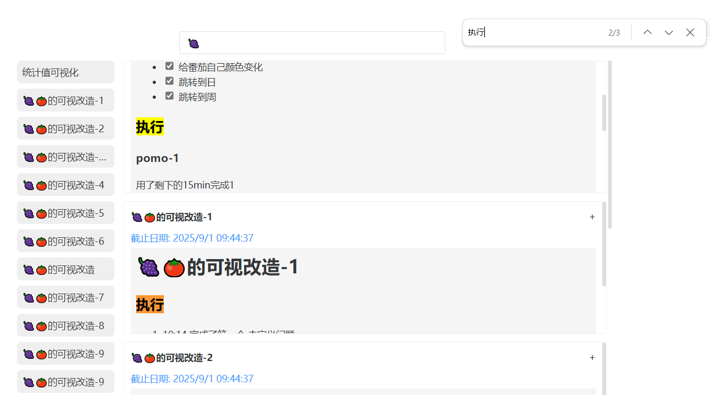
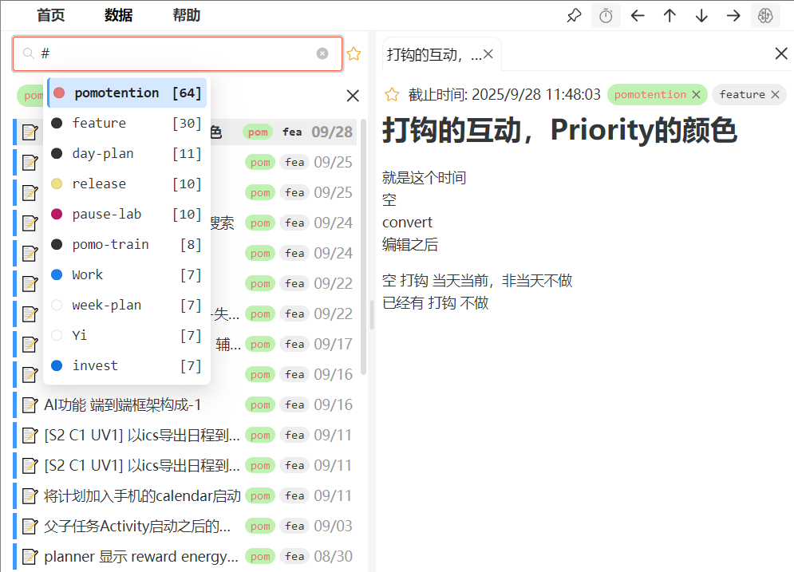
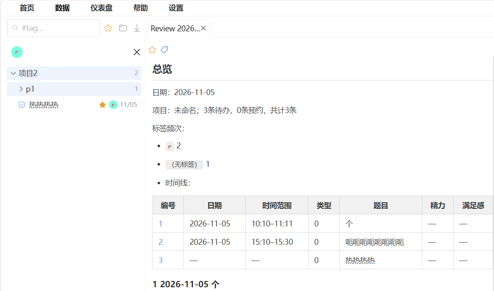

# 数据查看说明

::: tip
数据页用来 **找、归堆、打开详情、导出筛选结果**。列表以 Activity（计划侧待办 / 预约等）为主；**Project 文件夹** 用来把条目收成树，和标签筛选可叠加。
:::

## 快速导航

- 我想搜关键字 / 看高亮：见 [基础搜索与高亮](#基础搜索与高亮)
- 我想按标签过滤：见 [标签筛选](#标签筛选)
- 我想只看加星：见 [星标筛选](#星标筛选)
- 我想用文件夹归堆：见 [Project 文件夹](#project-文件夹)
- 我想导出当前命中：见 [导出筛选结果](#导出筛选结果)
- 我想在手机上切布局：见 [手机布局三态](#手机布局三态)
- 我想在结果里继续编辑：见 [结果查看与编辑](#结果查看与编辑)
- 我想确认边界：见 [限制与说明](#限制与说明)

## 常用按钮

工具条与文件夹行上的图标一览（后文按场景展开）。

| 按钮图标 | 功能说明 |
| :---: | :--- |
|  | 搜索框前缀：输入关键字或 `#` 选标签 |
|  | 清空搜索框（有字时出现） |
|  | 仅显示有加星任务的条目 |
|  | 新建 **根** Project（未选中文件夹时） |
|  | 在 **当前选中** Project 下新建子文件夹 |
|  | 导出 **当前筛选命中**（Markdown / JSON / CSV） |
|  | 手机：在「列表整理 / 分屏 / 上满」间切换 |
|  | 清除全部标签筛选；或关闭已打开的标签页 |
|  | 文件夹行：展开 / 收起（合起时朝右） |
|  | 文件夹升一层（直至根） |
|  | 收起该文件夹整棵子树 |
|  | 按月分组开 / 关（仅无子文件夹时） |
|  | 绑定智能标签（并触发一次收纳） |
|  | 清除智能标签（不踢出已进堆条目） |
|  | 删除文件夹（软删子树；条目只移出不删） |
|  | 列表行：待办类型标记（可拖进 / 出文件夹） |
|  | 列表行：预约类型标记（可拖进 / 出文件夹） |

## 基础搜索与高亮

- 菜单栏点 `数据` 进入；列表默认按时间倒序。
- 搜索框输入关键词后 **实时过滤**。匹配范围：
  - Activity **标题**
  - 关联任务里的标题 / 描述等文本（有任务时）
- 有搜索词时，命中处会在 **结果列表标题、已打开标签页标题、详情正文** 里自动高亮。
- **清空搜索框**（输入框右侧清空，或删光文字）→ 上述高亮立刻全部消失，含早已打开的详情。
- 输入 `#` 可弹出标签选择，用来加筛选条件（见下节）。
- 页面内仍可用浏览器 `Ctrl + F` / `Cmd + F` 做二次检索。  
  

## 标签筛选

- 点击数据页上已显示的标签，立即按该标签筛左侧列表。
- 多标签叠加为 **AND**：须同时带上所选标签。
- 再点已激活标签可取消该条件；筛选条上的清除按钮可一次清空。
- 搜索框输入 `#` 也可快速选标签。  
  

更多打标方式见 [标签系统](./tag.md)。

## 星标筛选

- 点工具条 ，只保留 **至少有一条加星任务** 的 Activity。
- 可与标签、关键字、Project 选中范围叠加。

## Project 文件夹

在数据页用浅紫的 **文件夹行** 组织计划侧条目（待办 / 预约等）。一条 Activity **只进一个** Project；跨主题继续靠标签，不必双挂文件夹。  
  

### 建、改名、层级

- **新建根文件夹**：工具条文件夹图标（未选中任何 Project 时）。
- **新建子文件夹**：先选中某个 Project，再点工具条（图标变为「箭头进文件夹」）；或在该行用新建子项操作。
- **改名**：电脑 **双击** 标题；手机 **连点两下**。
- **改层级**：拖文件夹进 / 出另一个文件夹；或用  **升一层**（直到根）。
- **开合**：行左侧 chevron；可用  **收起整棵子树**。
- 行末数字 = 在 **当前筛选** 下，该文件夹（含子树）可见命中条数。

### 把条目放进 / 移出

- **拖** 列表里的待办 / 预约行，放到目标 Project 上 → 归入。
- 拖到列表根区域（或空隙）→ 移出文件夹（清归属）。
- 手动拖进 / 拖出 **永远有效**，不会被智能归堆擅自改掉。

### 智能标签与收纳

- 文件夹可 **绑定一个智能标签**（）；同一标签全局最多绑一个文件夹。
- **仅当条目还没有文件夹归属** 时，智能才会写入：绑 tag 时会顺带对现有无归属条目做一次收纳；之后加 / 改标签也会按规则尝试归入。
- 多个候选文件夹时：**树更深优先**。
- **已有归属** 的条目：删标签也不会被自动踢出或换堆；清绑（）只去掉智能标签，不拆已进堆的条目。
- 拖文件夹改层级、拖条目进 / 出 **不会** 立刻重跑智能；深度变化只影响以后新归堆。

### 按月分组

- 仅当该文件夹 **没有子文件夹** 时，可用  打开 **按月**。
- 按月是 **视图桶**，不会新建真实子文件夹。

### 删除

- 删文件夹会软删整棵子树；里面的 Activity **先清归属、不删实体**，再按智能规则尝试重新归堆。

## 导出筛选结果

与设置里的 **全量数据备份** 不同：这里只导出 **当前筛选命中的计划侧条目**（待办 / 预约等），不含生活记录、账本日桶等。

1. 先用关键字、标签、星标、选中 Project 等把列表筛到你要的范围。
2. 点 （无命中时按钮不可用）。
3. 选择格式：
   - **Markdown**：复盘向报告（可先 **预览** 再导出）
   - **JSON**：结构化，便于再加工
   - **CSV**：Todo / Schedule 分列；两类都有时可能是两个文件
4. 桌面端优先落盘；网页 / PWA 走下载或系统分享。分享若取消，不会再偷偷下一份。

文件里会带范围信息（如 Project、标签、关键字等），方便事后知道「这次筛了什么」。

## 手机布局三态

搜索行旁的  在三种布局间循环（桌面不用）：

| 状态 | 作用 |
| --- | --- |
| **列表整理** | 列表占满；点行 **不打开详情、不选中**，方便滚动与长按拖拽归堆 |
| **分屏** | 上列表、下详情（默认） |
| **上满** | 藏列表，详情占满；搜索行仍保留，可再切回 |

整理态下用 **长按拖拽** 移动条目或文件夹；需要点开详情时先切到分屏。

## 结果查看与编辑

- 点左侧条目，右侧打开标签页显示详情（标题、正文、日期、标签等）。
- 详情支持 Markdown 阅读主题与 **目录（TOC）**（设置里可调阅读相关项）；手机上目录叠在元信息与正文之间，可收起。
- 右上角可批量关闭已打开标签页。
- 详情区可：切换星标、增删标签（见 [标签系统](./tag.md)）。

## 限制与说明

- 数据页 **不替代** 计划表排日；这里偏查找、归堆与导出素材。
- 导出是当前命中快照，**不是** 账号全量备份；全量见 [账号与数据](../intro/account-and-data.md)。
- 生活记录、账本等不会出现在本页主列表，也不会进「筛选导出」。
- Project 与云同步：登录且权益有效时，文件夹会随同步上下传；与标签一样走本地优先 / 后写覆盖策略。
- 周期很长、目标常变时的 backlog 写法，可另见 [长期事项与待办库存](../practices/long-horizon-inventory.md)。
